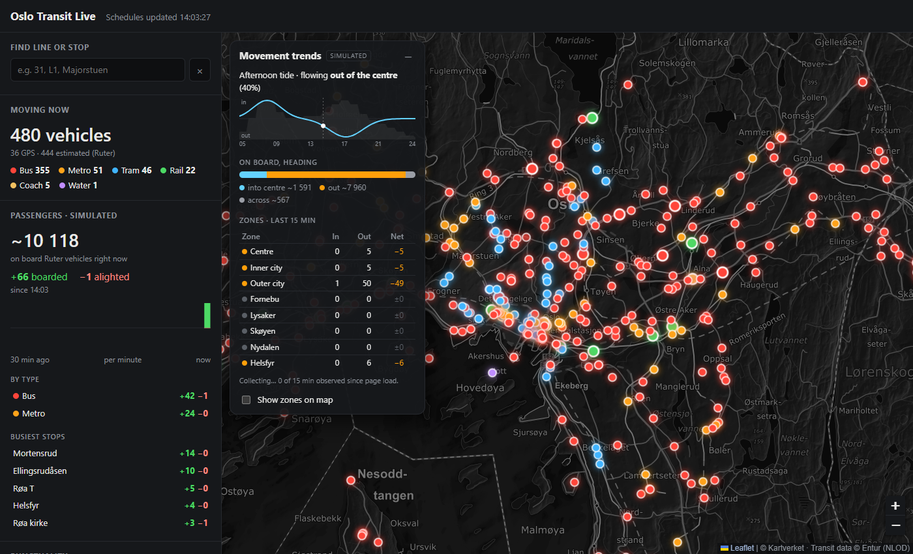

# Oslo Transit Live

A live map of public transport in Oslo, built on open data from [Entur](https://developer.entur.org/) and a dark
version of [Kartverket](https://www.kartverket.no/)'s map. It runs entirely in the browser, with no server, build
step or API keys.

## Features

- **Live vehicles.** About 450 buses, trams, metro trains, trains and boats at midday.
  - Ruter vehicles are *estimated* from live departure times and move along their real route shapes.
  - Trains and regional buses use their reported GPS positions.
- **Follow a vehicle.** Click a vehicle to follow it with a smoothed camera. The info panel shows delay, next stop,
  upcoming stops, live coordinates (lat/lon and UTM 33N) and a compass with heading and speed. The route ahead is
  drawn faintly on the map.
- **Search.** Find a line (`31`, `L1`) to highlight its vehicles and routes, or a stop (`Majorstuen`) to see the
  vehicles due there in the next 20 minutes.
- **Dashboard.** Vehicle counts by type, punctuality, the most delayed trips, and passenger figures.
- **Passenger data.**
  - For trains, Flytoget and some coaches, an approximate passenger count based on the operator's reported
    occupancy level.
  - For Ruter, a **simulated** model of boardings and alightings. It's based on time of day, how busy each stop is,
    the morning/afternoon commute and delays.
- **Movement trends.** A panel with the commute direction over the day, the inbound/outbound balance and flows per
  zone. A toggle draws the zones on the map.

## Important: estimated and simulated data

- **Ruter positions are estimates.** Ruter doesn't publish vehicle GPS positions to Entur, so each position is
  calculated from live departure times along the route.
- **Ruter passenger numbers are simulated.** No open source publishes boarding counts. The model is meant to
  illustrate likely patterns and isn't a measurement.
- **Other passenger numbers are approximate.** For trains and coaches they're derived from coarse occupancy
  categories, using assumed vehicle capacities.

The interface labels these values as *estimated* or *simulated* wherever they appear.

## Running it

The site is three static files, so there's nothing to install.

- **Locally:** open `index.html` in a modern browser (Edge, Chrome, Firefox or Safari).
- **Hosted:** serve the folder from any static host, such as GitHub Pages.

| File | Contents |
|---|---|
| `index.html` | Layout, styles and the security policy |
| `map.js` | Map setup and the darkened Kartverket base map (tiles are darkened once as they load) |
| `transit.js` | Data loading, vehicle animation, simulation, panels, search and camera |

## Configuration

Settings are constants near the code they affect in `transit.js`. Each has a comment explaining it. The most
useful ones:

| Constant | Purpose |
|---|---|
| `BBOX` | Area to load vehicles for |
| `HEADERS["ET-Client-Name"]` | Identifies the app to Entur. Use your own `company-application` name. |
| `TIDE_STRENGTH`, `DEST_WEIGHT`, `HOUR_DEMAND`, `DESTINATIONS` | Passenger simulation |
| `LABEL_ZOOM`, `FOCUS_ZOOM` | When line labels appear, and how far clicking a vehicle zooms in |
| `CAMERA_SMOOTH_MS`, `ANTI_FLICKER` | Follow-camera smoothing and the anti-flicker map softening |
| `frameMsForZoom`, `CANVAS_PAD` | Performance: animation rate by zoom, and the vehicle canvas margin |

The map's darkness is set by `TILE_CONTRAST` and `TILE_BRIGHTNESS` in `map.js`.

## Data sources and licences

| Source | Used for | Licence |
|---|---|---|
| [Entur Journey Planner API](https://developer.entur.org/pages-journeyplanner-journeyplanner) | Departures, real-time times, routes, stops | [NLOD](https://data.norge.no/nlod/en/2.0) |
| [Entur Vehicle Positions API](https://developer.entur.org/pages-real-time-vehicle-positions) | GPS positions, bearing, occupancy | [NLOD](https://data.norge.no/nlod/en/2.0) |
| [Kartverket](https://www.kartverket.no/api-og-data) (topograatone) | Base map tiles | [CC BY 4.0](https://creativecommons.org/licenses/by/4.0/) |
| [Leaflet 1.9.4](https://leafletjs.com/) via cdnjs | Map library | BSD-2-Clause |

Each visitor's browser calls the Entur APIs directly. Entur asks clients to identify themselves with
`ET-Client-Name` and to keep usage reasonable. For wider public use, set your own client name and follow
[Entur's guidelines](https://developer.entur.org/pages-intro-authentication).

## Security

- Text from the APIs is escaped before it's inserted into the page.
- Leaflet is loaded with Subresource Integrity hashes, so the browser rejects modified copies.
- A Content Security Policy only allows scripts from the site itself and cdnjs, data requests to Entur, and map
  tiles from Kartverket.
